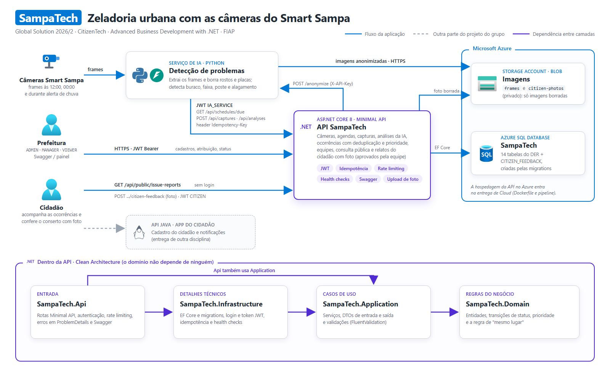

# SampaTech — API .NET

Global Solution 2026/2 (FIAP) · tema **CitizenTech** · disciplina *Advanced Business Development with .NET*.

## A solução

São Paulo já tem milhares de câmeras do **Smart Sampa** espalhadas pela cidade. O SampaTech reaproveita essas
imagens para a **zeladoria urbana**: em horários fixos (12:00 e 00:00) e durante alertas de chuva forte, frames
das câmeras são analisados por IA, que detecta **buracos, faixas apagadas, postes apagados e vias alagadas**.
Cada detecção vira uma **ocorrência** priorizada, a prefeitura atribui uma equipe e o cidadão acompanha o status.
Depois do conserto, o **cidadão confere com uma foto pelo app**: confirma que ficou resolvido ou contesta ("o
buraco continua lá"). A equipe revisa a foto; contestação aprovada reabre a ocorrência.

**Privacidade:** rostos e placas são borrados antes de qualquer imagem ser salva. A API recusa imagens que não
foram anonimizadas.

Esta API é o núcleo da solução: cadastros (câmeras, agendas, órgãos, equipes), registro das capturas e das
análises da IA, abertura e deduplicação de ocorrências, fluxo de atendimento, consulta pública e os relatos
dos cidadãos com foto.

## Arquitetura



O desenho é gerado a partir de [`docs/arquitetura.html`](docs/arquitetura.html), com os ícones oficiais do Azure,
do .NET, do Python e do FastAPI.

O código segue **Clean Architecture** em quatro projetos (faixa roxa do desenho): as setas indicam quem depende
de quem, e o domínio não depende de ninguém.

| Projeto | Responsabilidade |
|---|---|
| `src/SampaTech.Domain` | Entidades, regras puras (transições de status, prioridade, "mesmo lugar") e exceções de domínio. |
| `src/SampaTech.Application` | Casos de uso, DTOs de entrada e saída, validações (FluentValidation) e interfaces. |
| `src/SampaTech.Infrastructure` | EF Core com SQL Server, migrations, login e token JWT, idempotência, health checks, chamada à IA para borrar fotos e Blob Storage. |
| `src/SampaTech.Api` | Rotas Minimal API, autenticação, rate limiting, tratamento global de erros e Swagger. |
| `tests/SampaTech.UnitTests` | 247 testes de domínio, validações, JWT, configuração e cliente da IA. |
| `tests/SampaTech.IntegrationTests` | 54 testes da API inteira contra um SQL Server real em container. |

**Stack:** .NET 8, ASP.NET Core Minimal API, EF Core 8, SQL Server (Azure SQL na nuvem, Docker no local),
JWT, FluentValidation, Swagger, Azure Blob Storage (Azurite no local), xUnit, WebApplicationFactory,
Testcontainers e Respawn.

## Como rodar

**Pré-requisitos:** [.NET SDK 8](https://dotnet.microsoft.com/download/dotnet/8.0) e
[Docker](https://www.docker.com/products/docker-desktop/).

**1. Banco de dados e armazenamento de fotos (Docker)**

O `docker compose` sobe o **SQL Server** e o **Azurite** (emulador do Azure Blob Storage, onde ficam as fotos dos
cidadãos). No ambiente `Development`, a API já aponta para o Azurite (`UseDevelopmentStorage=true`).

```bash
cp .env.example .env
```

Abra o `.env` e preencha `MSSQL_SA_PASSWORD` **antes de subir o banco**:

- mínimo de **8 caracteres** e **3 destes 4 tipos**: maiúscula, minúscula, número e símbolo (regra do SQL Server;
  recomendado: 12 ou mais, com os 4 tipos), por exemplo `Sampa#Local2026`;
- evite `$`, aspas, `;` e espaço, que atrapalham os comandos;
- o SQL Server só lê essa senha **na primeira vez** que cria o volume. Para trocá-la depois, veja
  [Problemas comuns](#problemas-comuns).

Se o campo ficar vazio, o Docker Compose para com a mensagem `Defina MSSQL_SA_PASSWORD no arquivo .env`. Depois de
preencher:

```bash
docker compose up -d
```

Espere o container ficar `(healthy)` antes de seguir (cerca de 30 segundos):

```bash
docker ps --format "{{.Names}}  {{.Status}}"
```

**2. Configuração da API**

Segredos nunca ficam em arquivo versionado. No ambiente local eles vão para o *user-secrets* do .NET; o formato
completo está em [`src/SampaTech.Api/appsettings.example.json`](src/SampaTech.Api/appsettings.example.json).

```bash
dotnet user-secrets set "ConnectionStrings:DefaultConnection" "Server=localhost,1433;Database=SampaTech;User Id=sa;Password=<senha-do-.env>;TrustServerCertificate=True" --project src/SampaTech.Api
```

```bash
dotnet user-secrets set "Jwt:Key" "<chave com 32+ caracteres; ex.: openssl rand -base64 48>" --project src/SampaTech.Api
```

Gere o hash de uma senha (a senha em si nunca é guardada):

```bash
dotnet run --project src/SampaTech.Api -- hash-password "MinhaSenha@123"
```

Copie só a linha do hash (começa com `AQAAAA`); na primeira execução aparece antes a linha `Compilando...`,
que não faz parte dele. E cadastre o usuário com o hash gerado (repita com os índices 1, 2… para outros usuários e papéis):

```bash
dotnet user-secrets set "Auth:Users:0:Username" "admin" --project src/SampaTech.Api
```

```bash
dotnet user-secrets set "Auth:Users:0:PasswordHash" "<hash gerado acima>" --project src/SampaTech.Api
```

```bash
dotnet user-secrets set "Auth:Users:0:Role" "ADMIN" --project src/SampaTech.Api
```

Os usuários são conferidos na subida: papel inexistente, hash vazio ou nome repetido impedem a API de iniciar,
com uma mensagem dizendo o que corrigir.

Para demonstrar o fluxo do cidadão, cadastre também um usuário com o papel `CITIZEN` (ex.: `cidadao-demo`, no
índice seguinte). E, para a foto ser borrada e conferida, aponte a API para o serviço de IA (com o mesmo `IA_API_KEY` do
`.env` dele):

```bash
dotnet user-secrets set "AiService:BaseUrl" "http://localhost:8000" --project src/SampaTech.Api
```

```bash
dotnet user-secrets set "AiService:ApiKey" "<IA_API_KEY do serviço de IA>" --project src/SampaTech.Api
```

Sem o serviço de IA no ar, o envio da foto responde `503` e nada é guardado; o resto da API funciona normalmente.

Para o app do cidadão usar o login da API Java (opcional), configure o mesmo `JWT_SECRET` dela. Sem essa chave,
a API sobe normalmente e só não aceita tokens da Java:

```bash
dotnet user-secrets set "JavaAuth:Secret" "<JWT_SECRET da API Java>" --project src/SampaTech.Api
```

**3. Tabelas (migrations)**

```bash
dotnet tool restore
```

```bash
dotnet ef database update --project src/SampaTech.Infrastructure --startup-project src/SampaTech.Api
```

**4. Subir a API**

```bash
dotnet run --project src/SampaTech.Api
```

Abra o Swagger em **http://localhost:5242/swagger**, faça login em `POST /api/auth/login`, copie o
`accessToken` e cole no botão **Authorize**.

**5. Testes**

```bash
dotnet test SampaTech.sln
```

Os testes de integração precisam do Docker ligado: eles sobem um SQL Server próprio, descartável, e não usam o
seu banco nem os seus segredos.

### Problemas comuns

| Sintoma | Causa | Solução |
|---|---|---|
| `docker compose up` para com `Defina MSSQL_SA_PASSWORD no arquivo .env` | A senha do `.env` está vazia | Preencha `MSSQL_SA_PASSWORD` no `.env` (passo 1). |
| O container não fica `(healthy)` e `docker logs sampatech-sql` mostra `Password validation failed` | Senha fraca para o SQL Server | Use 8+ caracteres com 3 dos 4 tipos e recrie: `docker compose down -v && docker compose up -d`. |
| `Login failed for user 'sa'` no `dotnet ef database update` ou na API | A senha da connection string não é a que o SQL guardou. Acontece quando o `.env` muda depois da primeira subida (o SQL só lê a senha ao criar o volume) ou quando o terminal tem uma variável `MSSQL_SA_PASSWORD` definida, que passa na frente do `.env` | Confira se a senha da connection string é a mesma do `.env`. Rode `unset MSSQL_SA_PASSWORD` e recrie o banco local: `docker compose down -v && docker compose up -d` (apaga os dados locais). |
| `A connection was successfully established with the server, but then an error occurred during the pre-login handshake` | O SQL Server ainda está ligando | Espere o `(healthy)` em `docker ps` e rode de novo. |
| Login da API responde `401` com a senha certa | O hash foi copiado com a linha `Compilando...` | Gere de novo com `hash-password` e copie só a linha que começa com `AQAAAA`. |
| A API não sobe e diz qual `Auth:Users` corrigir | Papel inexistente, hash vazio ou usuário repetido | Use os papéis `ADMIN`, `MANAGER`, `VIEWER`, `IA_SERVICE` ou `CITIZEN` e corrija a posição indicada. |
| `dotnet ef` não é reconhecido | A ferramenta local não foi restaurada | Rode `dotnet tool restore` na raiz do repositório. |
| Envio da foto responde `503` "O serviço de IA..." | O serviço de IA está desligado, sem `AiService:BaseUrl`, com `AiService:ApiKey` diferente da `IA_API_KEY` dele, ou sem o LLM configurado lá (variáveis `LLM_*`) | Suba o serviço de IA e confira as configurações. A primeira foto demora alguns segundos (os modelos carregam). |
| Envio da foto responde `422` "Foto recusada pela IA" | A IA conferiu a foto e ela não mostra o local da ocorrência (ex.: selfie, animal, print de tela); o motivo vem no `detail` | Comportamento esperado: mande uma foto da rua. Nada foi guardado. |
| Token da API Java responde `401` | `JavaAuth:Secret` diferente do `JWT_SECRET` da Java, token vencido (120 min) ou papel que não é `CITIZEN` | Confira o segredo (precisa ser idêntico) e faça login de novo na Java. `AGENT` e `ADMIN` da Java não entram na .NET, de propósito. |
| Envio da foto responde `503` "O armazenamento de fotos..." | O Azurite (ou a Storage Account) não está no ar | Rode `docker compose up -d` e confira o `sampatech-azurite` em `docker ps`. |

## Autenticação e papéis

Login em `POST /api/auth/login` devolve um **JWT (HS256) válido por 60 minutos**. Por padrão, toda rota exige
login; só o login, a consulta pública e os health checks são abertos.

| Papel | Pode | Quem usa |
|---|---|---|
| `ADMIN` | Tudo, inclusive **apagar** registros | Administração da plataforma |
| `MANAGER` | Consultar, cadastrar, atualizar, ativar/desativar, atribuir equipes e mudar status | Gestores da prefeitura |
| `VIEWER` | Só consultar | Consulta interna |
| `IA_SERVICE` | Registrar capturas e análises e consultar as agendas devidas | Serviço de IA (Python) |
| `CITIZEN` | Confirmar ou contestar, com foto, o conserto de uma ocorrência e acompanhar os próprios relatos | Cidadão (app mobile) |

Os papéis da prefeitura formam uma escada (`ADMIN › MANAGER › VIEWER`); o serviço de IA e o cidadão são separados
e não acessam as rotas da prefeitura. O cidadão entra de dois jeitos, nas mesmas rotas:

- **Token da API Java** (o app do cidadão): a .NET confere a assinatura com o mesmo `JWT_SECRET` da Java
  (`JavaAuth:Secret`) e a validade (120 min). O token da Java não tem emissor nem público, então a API olha o
  token antes de validar: com o emissor da .NET, vai para o validador da .NET; sem emissor, para o da Java.
  Da Java, **só o papel `CITIZEN` passa**: `AGENT` e `ADMIN` recebem `401`, e o cidadão não acessa as rotas da
  prefeitura (`403`). O e-mail (`sub`) vira um código (`java:` + SHA-256 do e-mail): o mesmo cidadão sempre
  tem o mesmo código e vê só os próprios relatos, mas o e-mail não é gravado na .NET.
- **Usuário de configuração da própria API** (ex.: `cidadao-demo`): para a demonstração e como plano B se a
  API Java estiver fora do ar.

## Rotas

Todas as respostas de erro seguem o padrão **ProblemDetails** (RFC 7807), com mensagens em português.

| Recurso | Rotas | Papel mínimo |
|---|---|---|
| Login | `POST /api/auth/login` | — |
| Pontos monitorados | `GET`, `POST`, `PUT`, `DELETE /api/monitoring-points` | leitura VIEWER · escrita MANAGER · apagar ADMIN |
| Câmeras | `GET`, `POST`, `PUT`, `DELETE /api/cameras` | idem |
| Agendas de captura | `/api/cameras/{cameraId}/schedules` (+ `PATCH .../activate` e `.../deactivate`) | idem |
| Órgãos municipais | `/api/municipal-agencies` (+ ativar/desativar) | idem |
| Equipes | `/api/teams` (+ ativar/desativar) | idem |
| Tipos de problema | `/api/issue-types` (+ ativar/desativar) | idem |
| Alertas de chuva | `/api/trigger-events` (+ `PATCH .../end`) | idem |
| Agendas devidas | `GET /api/schedules/due` | IA_SERVICE |
| Capturas | `GET /api/captures` · `POST /api/captures` | leitura VIEWER · registro IA_SERVICE |
| Análises da IA | `GET /api/analyses/{id}` · `POST /api/analyses` | leitura VIEWER · registro IA_SERVICE |
| Ocorrências | `GET /api/issue-reports` · `PATCH .../status` · `POST .../assignments` | leitura VIEWER · ações MANAGER |
| Consulta pública | `GET /api/public/issue-reports` (com `citizenConfirmations` e `citizenContests`) | sem login |
| Relato do cidadão (foto) | `POST /api/issue-reports/{id}/citizen-feedback` (multipart: `decision`, `notes`, `latitude`, `longitude`, `photo`) | CITIZEN |
| Relatos: fila e revisão | `GET /api/citizen-feedback` · `PATCH /api/citizen-feedback/{id}/review` | leitura VIEWER · revisão MANAGER |
| Relato e foto | `GET /api/citizen-feedback/{id}` · `GET /api/citizen-feedback/{id}/photo` | equipe, ou o próprio cidadão |
| Health checks | `GET /health/live` · `GET /health` | sem login |

Códigos usados: `200`, `201` (com `Location`), `204`, `400` (validação, com o campo e o motivo), `401`, `403`,
`404`, `409` (conflito, ex.: código repetido ou registro em uso), `422` (chave de idempotência reaproveitada com
outro conteúdo, ou foto recusada pela IA no relato do cidadão), `413` (foto acima de 5 MB), `429` (limite de requisições) e `503` (health check com o banco fora
do ar, ou serviço de IA e armazenamento indisponíveis no envio da foto).

## Regras de negócio

- **Agendas:** cada câmera tem agendas de **12:00 ou 00:00** (horário de São Paulo), opcionalmente num dia da
  semana. O meio-dia procura buracos, faixas e postes; a meia-noite, postes apagados. Enquanto houver um
  **alerta de chuva** ativo, as câmeras também geram frames a cada 3 horas para detectar alagamentos.
  O serviço de IA pergunta em `GET /api/schedules/due` quais frames extrair agora.
- **Confiança mínima:** detecções com confiança abaixo de **0,5** ficam registradas, mas não abrem ocorrência.
- **Deduplicação:** uma detecção soma numa ocorrência aberta do mesmo tipo quando vem da **mesma câmera** ou do
  **mesmo lugar** (mesma rua, mesmo lado e até 30 de diferença na altura da numeração). Assim, um buraco visto
  todos os dias não vira dezenas de ocorrências.
- **Prioridade (0 a 100):** severidade (15 a 60) + recorrência (5 por detecção extra, até 25) + 1 por dia em
  aberto (até 15). A lista da prefeitura vem ordenada pela maior prioridade.
- **Fluxo de status:** `OPEN → ASSIGNED → IN_PROGRESS → RESOLVED`, com `REJECTED` (motivo obrigatório) a partir
  de `OPEN` ou `ASSIGNED`. Cada mudança fica no histórico com o usuário que fez.
- **Relato do cidadão:** só numa ocorrência **resolvida**. O cidadão confirma (`CONFIRM`) ou contesta (`CONTEST`,
  motivo obrigatório) com uma foto JPG ou PNG de até 5 MB. A API pede ao serviço de IA para borrar rostos e
  placas e **conferir a foto**: um LLM de visão responde se é uma via pública, se é o tipo de lugar certo e se
  mostra o problema, e a regra fica no código da IA (contestar exige ver o problema; confirmar exige o tipo de
  lugar certo, porque não dá para fotografar um buraco que já não existe). Foto recusada responde `422` com o
  motivo, e nada é gravado. Aceita, a API **só guarda a versão borrada**; o relato nasce `PENDING` ("Foto recebida e validada pela IA. Aguardamos
  a aprovação da equipe para confirmar o relato."). A equipe vê a foto e aprova ou recusa (recusa exige motivo):
  - confirmação aprovada: "Ocorrência resolvida e validada por N cidadão(s)" (fica no histórico);
  - contestação aprovada: a ocorrência volta para `OPEN` e entra de novo na fila da equipe.
- **Consulta pública:** o cidadão vê as ocorrências sem dados internos (usuários, observações, equipes e
  prioridade); ocorrências rejeitadas não aparecem.

## Decisões técnicas

| Tema | Decisão | Por quê |
|---|---|---|
| **Idempotência** | Header `Idempotency-Key` obrigatório em `POST /api/captures`, `POST /api/analyses` e no envio da foto do cidadão (no formulário, a impressão digital inclui o SHA-256 da foto); a resposta fica guardada no banco. Reenvio com o mesmo conteúdo devolve a resposta original (`Idempotency-Replayed: true`); com outro conteúdo, `422`. | O serviço de IA reenvia quando a rede falha. Sem isso, a mesma foto viraria duas capturas e duas ocorrências. Há ainda uma segunda proteção: índice único por câmera e horário. |
| **Rate limiting** | Login: 5 por minuto por IP (janela fixa). Serviço de IA: balde de 100 fichas, +50 por minuto. Rota pública: 60 por minuto por IP (janela deslizante). Demais rotas: 120 por minuto por usuário. Resposta `429` com `Retry-After`. | Cada rota tem um risco: adivinhação de senha no login, rajadas legítimas da IA em dia de chuva, abuso na rota aberta. Os limites ficam no `appsettings` e podem ser ajustados sem recompilar. |
| **Health checks** | `/health/live` só responde se o processo está de pé; `/health` verifica o banco (e o serviço de IA, o Blob e o RabbitMQ quando configurados), com tempo-limite de 3 s. Respostas em JSON, sem detalhes de erro. | O Azure reinicia a API pelo `/health/live`; se o banco cair, reiniciar não resolve, então o `/health` só informa `503`. Serviços externos fora do ar deixam a API `Degraded`, não `Unhealthy`, porque ela continua útil. |
| **Erros** | Um tratador global converte exceções em ProblemDetails; erros de chave única e de FK do SQL Server viram `409` com mensagem amigável. | Formato único para quem consome a API e nenhum detalhe interno exposto. |
| **Banco** | Nomes de tabelas e colunas iguais ao modelo relacional do grupo; índices únicos filtrados (captura por câmera e horário; uma atribuição aberta por ocorrência). | O banco segue o modelo relacional definido pelo grupo, e as regras de unicidade ficam garantidas pelo banco, não só pelo código. |
| **Fotos do cidadão** | A API recebe o arquivo, confere o formato pelos bytes (não pela extensão), pede ao serviço de IA para borrar e conferir a foto (`POST /verificar-foto`, com o tipo do problema e a decisão) e guarda só a versão borrada num container **privado** do Blob. A foto sai só por `GET /api/citizen-feedback/{id}/photo`, com login. Tabela nova `CITIZEN_FEEDBACK` (fora do DER original, avisada ao grupo). | A promessa de privacidade vale também para as fotos do app: sem a IA, nada é guardado (`503`). A conferência barra fotos que não servem como prova antes de chegarem à equipe (`422`), e a decisão final continua humana. O relato precisa de um ciclo próprio (pendente, aprovado, recusado) e de contagem, o que não cabe no histórico. |
| **Datas** | Instantes gravados em UTC; regras de relógio (12:00, 00:00) no fuso `America/Sao_Paulo`. | Evita erro de fuso entre o servidor na nuvem e o horário da cidade. |
| **Login do cidadão pela API Java** | A .NET aceita o token da Java só para o papel `CITIZEN`, com um validador próprio (sem emissor e público, que a Java não envia) escolhido pela presença do emissor no token, e grava um código derivado do e-mail no lugar dele. | O cidadão entra uma vez só no app, sem cadastro duplicado. Restringir o papel impede que um `ADMIN` da Java vire `ADMIN` na .NET, e o código cumpre a minimização de dados (LGPD): a .NET só precisa saber que é a mesma pessoa. |
| **Segredos** | Senhas guardadas só como hash (PBKDF2); chave JWT e connection strings no user-secrets (local) ou em variáveis de ambiente (Azure). | Nenhuma credencial no repositório, que é público. |

## Testes

```bash
dotnet test SampaTech.sln
```

- **Unitários (247):** regras do domínio (transições, prioridade, deduplicação, agendas, relato do cidadão e
  reabertura), validações, login e token, validação dos usuários na subida, registro dos health checks, formato
  da foto e o cliente do serviço de IA (aceite, recusa com motivo, resposta fora do contrato, fora do ar e erro
  viram `503`).
- **Integração (54):** a API inteira em memória (`WebApplicationFactory`) contra um **SQL Server real** em
  container (Testcontainers), com o banco limpo antes de cada teste (Respawn). Cobrem:
  - segurança: `401` sem token ou com token adulterado, `403` por papel;
  - CRUD de câmeras: `201`, `404`, `409`, `400` com o campo;
  - fluxo central: captura → análise → ocorrência visível para a prefeitura e o cidadão, deduplicação e
    confiança baixa;
  - idempotência: reenvio, `422` e índice único;
  - rate limiting (`429` com `Retry-After`) e health checks;
  - relato do cidadão: envio com foto, aprovação (validada por N cidadãos), contestação que reabre, recusa com
    motivo, `409` em ocorrência não resolvida, `401` e `403`, `400`, `413`, foto recusada pela IA (`422` sem gravar
    nada), o tipo do problema e a decisão enviados à IA, IA fora do ar (`503` sem gravar nada),
    reenvio idempotente e a foto vista pela equipe (IA e Blob simulados nos testes);
  - token da API Java (gerado no mesmo formato dela, HS256 e HS512): cidadão envia e vê o próprio relato, o
    relato guarda o código e não o e-mail, um cidadão não vê o relato de outro, `ADMIN` e `AGENT` da Java
    recebem `401`, cidadão recebe `403` nas rotas da prefeitura, e assinatura errada ou token vencido dão `401`.

## Uso de IA generativa

**Ferramenta:** Claude Code (Anthropic).

**Para que foi usada:**
- **Implementação assistida:** o código foi escrito com apoio da IA, em passos pequenos. Antes de cada passo,
  as alternativas técnicas (com prós e contras) foram apresentadas, e a escolha foi feita pelo autor. As
  principais estão na seção [Decisões técnicas](#decisões-técnicas).
- **Explicação de conceitos e erros:** por exemplo, idempotência, rate limiting, health checks e o
  comportamento do SqlClient com o servidor fora do ar.
- **Testes e revisão:** sugestão de casos de teste e ensaios em ambiente descartável antes de cada entrega.

**Como garantimos entendimento e revisão:**
- Cada etapa foi testada manualmente (Swagger e curl) antes do commit.
- Todo o código foi revisado e commitado pelo autor, em PRs por funcionalidade.
- 301 testes automatizados (247 unitários e 54 de integração com SQL Server real).

## Integrantes

| Nome | RM | Turma |
|---|---|---|
| Ana Carolina Pereira Fontes | RM562145 | 2TDSPV |
| João Victor Nascimento Adão | RM563409 | 2TDSPX |
| Johnny Dias Mathias Junior | RM566516 | 2TDSPX |
| Luisa Ganasevici de Abreu | RM563403 | 2TDSPV |
| Matheus Moya de Oliveira | RM562822 | 2TDSPV |
