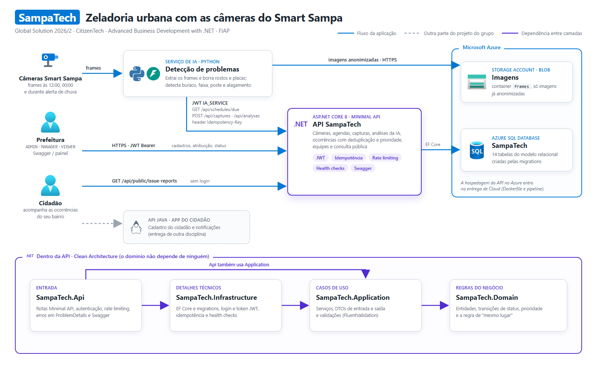

# SampaTech — API .NET

Global Solution 2026/2 (FIAP) · tema **CitizenTech** · disciplina *Advanced Business Development with .NET*.

## A solução

São Paulo já tem milhares de câmeras do **Smart Sampa** espalhadas pela cidade. O SampaTech reaproveita essas
imagens para a **zeladoria urbana**: em horários fixos (12:00 e 00:00) e durante alertas de chuva forte, frames
das câmeras são analisados por IA, que detecta **buracos, faixas apagadas, postes apagados e vias alagadas**.
Cada detecção vira uma **ocorrência** priorizada, a prefeitura atribui uma equipe e o cidadão acompanha o status.

**Privacidade:** rostos e placas são borrados antes de qualquer imagem ser salva. A API recusa imagens que não
foram anonimizadas.

Esta API é o núcleo da solução: cadastros (câmeras, agendas, órgãos, equipes), registro das capturas e das
análises da IA, abertura e deduplicação de ocorrências, fluxo de atendimento e consulta pública.

## Arquitetura



O desenho é gerado a partir de [`docs/arquitetura.html`](docs/arquitetura.html), com os ícones oficiais do Azure,
do .NET, do Python e do FastAPI.

O código segue **Clean Architecture** em quatro projetos (faixa roxa do desenho): as setas indicam quem depende
de quem, e o domínio não depende de ninguém.

| Projeto | Responsabilidade |
|---|---|
| `src/SampaTech.Domain` | Entidades, regras puras (transições de status, prioridade, "mesmo lugar") e exceções de domínio. |
| `src/SampaTech.Application` | Casos de uso, DTOs de entrada e saída, validações (FluentValidation) e interfaces. |
| `src/SampaTech.Infrastructure` | EF Core com SQL Server, migrations, login e token JWT, idempotência e health checks. |
| `src/SampaTech.Api` | Rotas Minimal API, autenticação, rate limiting, tratamento global de erros e Swagger. |
| `tests/SampaTech.UnitTests` | 221 testes de domínio, validações, JWT e configuração. |
| `tests/SampaTech.IntegrationTests` | 31 testes da API inteira contra um SQL Server real em container. |

**Stack:** .NET 8, ASP.NET Core Minimal API, EF Core 8, SQL Server (Azure SQL na nuvem, Docker no local),
JWT, FluentValidation, Swagger, xUnit, WebApplicationFactory, Testcontainers e Respawn.

## Como rodar

**Pré-requisitos:** [.NET SDK 8](https://dotnet.microsoft.com/download/dotnet/8.0) e
[Docker](https://www.docker.com/products/docker-desktop/).

**1. Banco de dados (SQL Server em Docker)**

```bash
cp .env.example .env
```

Abra o `.env` e troque a senha (8+ caracteres, com maiúscula, minúscula, número e símbolo). Depois:

```bash
docker compose up -d
```

Espere o container ficar `(healthy)` em `docker ps` (cerca de 30 segundos).

**2. Configuração da API**

Segredos nunca ficam em arquivo versionado. No ambiente local eles vão para o *user-secrets* do .NET; o formato
completo está em [`src/SampaTech.Api/appsettings.example.json`](src/SampaTech.Api/appsettings.example.json).

```bash
dotnet user-secrets set "ConnectionStrings:DefaultConnection" "Server=localhost,1433;Database=SampaTech;User Id=sa;Password=<senha-do-.env>;TrustServerCertificate=True" --project src/SampaTech.Api
```

```bash
dotnet user-secrets set "Jwt:Key" "<chave com 32+ caracteres; ex.: openssl rand -base64 48>" --project src/SampaTech.Api
```

Gere o hash de uma senha (a senha em si nunca é guardada):

```bash
dotnet run --project src/SampaTech.Api -- hash-password "MinhaSenha@123"
```

E cadastre o usuário com o hash gerado (repita com os índices 1, 2… para outros usuários e papéis):

```bash
dotnet user-secrets set "Auth:Users:0:Username" "admin" --project src/SampaTech.Api
```

```bash
dotnet user-secrets set "Auth:Users:0:PasswordHash" "<hash gerado acima>" --project src/SampaTech.Api
```

```bash
dotnet user-secrets set "Auth:Users:0:Role" "ADMIN" --project src/SampaTech.Api
```

Os usuários são conferidos na subida: papel inexistente, hash vazio ou nome repetido impedem a API de iniciar,
com uma mensagem dizendo o que corrigir.

**3. Tabelas (migrations)**

```bash
dotnet tool restore
```

```bash
dotnet ef database update --project src/SampaTech.Infrastructure --startup-project src/SampaTech.Api
```

**4. Subir a API**

```bash
dotnet run --project src/SampaTech.Api
```

Abra o Swagger em **http://localhost:5242/swagger**, faça login em `POST /api/auth/login`, copie o
`accessToken` e cole no botão **Authorize**.

**5. Testes**

```bash
dotnet test SampaTech.sln
```

Os testes de integração precisam do Docker ligado: eles sobem um SQL Server próprio, descartável, e não usam o
seu banco nem os seus segredos.

## Autenticação e papéis

Login em `POST /api/auth/login` devolve um **JWT (HS256) válido por 60 minutos**. Por padrão, toda rota exige
login; só o login, a consulta pública e os health checks são abertos.

| Papel | Pode | Quem usa |
|---|---|---|
| `ADMIN` | Tudo, inclusive **apagar** registros | Administração da plataforma |
| `MANAGER` | Consultar, cadastrar, atualizar, ativar/desativar, atribuir equipes e mudar status | Gestores da prefeitura |
| `VIEWER` | Só consultar | Consulta interna |
| `IA_SERVICE` | Registrar capturas e análises e consultar as agendas devidas | Serviço de IA (Python) |

Os papéis da prefeitura formam uma escada (`ADMIN › MANAGER › VIEWER`); o serviço de IA é separado e não
acessa as rotas da prefeitura.

## Rotas

Todas as respostas de erro seguem o padrão **ProblemDetails** (RFC 7807), com mensagens em português.

| Recurso | Rotas | Papel mínimo |
|---|---|---|
| Login | `POST /api/auth/login` | — |
| Pontos monitorados | `GET`, `POST`, `PUT`, `DELETE /api/monitoring-points` | leitura VIEWER · escrita MANAGER · apagar ADMIN |
| Câmeras | `GET`, `POST`, `PUT`, `DELETE /api/cameras` | idem |
| Agendas de captura | `/api/cameras/{cameraId}/schedules` (+ `PATCH .../activate` e `.../deactivate`) | idem |
| Órgãos municipais | `/api/municipal-agencies` (+ ativar/desativar) | idem |
| Equipes | `/api/teams` (+ ativar/desativar) | idem |
| Tipos de problema | `/api/issue-types` (+ ativar/desativar) | idem |
| Alertas de chuva | `/api/trigger-events` (+ `PATCH .../end`) | idem |
| Agendas devidas | `GET /api/schedules/due` | IA_SERVICE |
| Capturas | `GET /api/captures` · `POST /api/captures` | leitura VIEWER · registro IA_SERVICE |
| Análises da IA | `GET /api/analyses/{id}` · `POST /api/analyses` | leitura VIEWER · registro IA_SERVICE |
| Ocorrências | `GET /api/issue-reports` · `PATCH .../status` · `POST .../assignments` | leitura VIEWER · ações MANAGER |
| Consulta pública | `GET /api/public/issue-reports` | sem login |
| Health checks | `GET /health/live` · `GET /health` | sem login |

Códigos usados: `200`, `201` (com `Location`), `204`, `400` (validação, com o campo e o motivo), `401`, `403`,
`404`, `409` (conflito, ex.: código repetido ou registro em uso), `422` (chave de idempotência reaproveitada com
outro conteúdo), `429` (limite de requisições) e `503` (health check com o banco fora do ar).

## Regras de negócio

- **Agendas:** cada câmera tem agendas de **12:00 ou 00:00** (horário de São Paulo), opcionalmente num dia da
  semana. O meio-dia procura buracos, faixas e postes; a meia-noite, postes apagados. Enquanto houver um
  **alerta de chuva** ativo, as câmeras também geram frames a cada 3 horas para detectar alagamentos.
  O serviço de IA pergunta em `GET /api/schedules/due` quais frames extrair agora.
- **Confiança mínima:** detecções com confiança abaixo de **0,5** ficam registradas, mas não abrem ocorrência.
- **Deduplicação:** uma detecção soma numa ocorrência aberta do mesmo tipo quando vem da **mesma câmera** ou do
  **mesmo lugar** (mesma rua, mesmo lado e até 30 de diferença na altura da numeração). Assim, um buraco visto
  todos os dias não vira dezenas de ocorrências.
- **Prioridade (0 a 100):** severidade (15 a 60) + recorrência (5 por detecção extra, até 25) + 1 por dia em
  aberto (até 15). A lista da prefeitura vem ordenada pela maior prioridade.
- **Fluxo de status:** `OPEN → ASSIGNED → IN_PROGRESS → RESOLVED`, com `REJECTED` (motivo obrigatório) a partir
  de `OPEN` ou `ASSIGNED`. Cada mudança fica no histórico com o usuário que fez.
- **Consulta pública:** o cidadão vê as ocorrências sem dados internos (usuários, observações, equipes e
  prioridade); ocorrências rejeitadas não aparecem.

## Decisões técnicas

| Tema | Decisão | Por quê |
|---|---|---|
| **Idempotência** | Header `Idempotency-Key` obrigatório em `POST /api/captures` e `POST /api/analyses`; a resposta fica guardada no banco. Reenvio com o mesmo conteúdo devolve a resposta original (`Idempotency-Replayed: true`); com outro conteúdo, `422`. | O serviço de IA reenvia quando a rede falha. Sem isso, a mesma foto viraria duas capturas e duas ocorrências. Há ainda uma segunda proteção: índice único por câmera e horário. |
| **Rate limiting** | Login: 5 por minuto por IP (janela fixa). Serviço de IA: balde de 100 fichas, +50 por minuto. Rota pública: 60 por minuto por IP (janela deslizante). Demais rotas: 120 por minuto por usuário. Resposta `429` com `Retry-After`. | Cada rota tem um risco: adivinhação de senha no login, rajadas legítimas da IA em dia de chuva, abuso na rota aberta. Os limites ficam no `appsettings` e podem ser ajustados sem recompilar. |
| **Health checks** | `/health/live` só responde se o processo está de pé; `/health` verifica o banco (e o serviço de IA, o Blob e o RabbitMQ quando configurados), com tempo-limite de 3 s. Respostas em JSON, sem detalhes de erro. | O Azure reinicia a API pelo `/health/live`; se o banco cair, reiniciar não resolve, então o `/health` só informa `503`. Serviços externos fora do ar deixam a API `Degraded`, não `Unhealthy`, porque ela continua útil. |
| **Erros** | Um tratador global converte exceções em ProblemDetails; erros de chave única e de FK do SQL Server viram `409` com mensagem amigável. | Formato único para quem consome a API e nenhum detalhe interno exposto. |
| **Banco** | Nomes de tabelas e colunas iguais ao modelo relacional do grupo; índices únicos filtrados (captura por câmera e horário; uma atribuição aberta por ocorrência). | O banco segue o modelo relacional definido pelo grupo, e as regras de unicidade ficam garantidas pelo banco, não só pelo código. |
| **Datas** | Instantes gravados em UTC; regras de relógio (12:00, 00:00) no fuso `America/Sao_Paulo`. | Evita erro de fuso entre o servidor na nuvem e o horário da cidade. |
| **Segredos** | Senhas guardadas só como hash (PBKDF2); chave JWT e connection strings no user-secrets (local) ou em variáveis de ambiente (Azure). | Nenhuma credencial no repositório, que é público. |

## Testes

```bash
dotnet test SampaTech.sln
```

- **Unitários (221):** regras do domínio (transições, prioridade, deduplicação, agendas), validações, login e
  token, validação dos usuários na subida e registro dos health checks.
- **Integração (31):** a API inteira em memória (`WebApplicationFactory`) contra um **SQL Server real** em
  container (Testcontainers), com o banco limpo antes de cada teste (Respawn). Cobrem:
  - segurança: `401` sem token ou com token adulterado, `403` por papel;
  - CRUD de câmeras: `201`, `404`, `409`, `400` com o campo;
  - fluxo central: captura → análise → ocorrência visível para a prefeitura e o cidadão, deduplicação e
    confiança baixa;
  - idempotência: reenvio, `422` e índice único;
  - rate limiting (`429` com `Retry-After`) e health checks.

## Uso de IA generativa

**Ferramenta:** Claude Code (Anthropic).

**Para que foi usada:**
- **Implementação assistida:** o código foi escrito com apoio da IA, em passos pequenos. Antes de cada passo,
  as alternativas técnicas (com prós e contras) foram apresentadas, e a escolha foi feita pelo autor. As
  principais estão na seção [Decisões técnicas](#decisões-técnicas).
- **Explicação de conceitos e erros:** por exemplo, idempotência, rate limiting, health checks e o
  comportamento do SqlClient com o servidor fora do ar.
- **Testes e revisão:** sugestão de casos de teste e ensaios em ambiente descartável antes de cada entrega.

**Como garantimos entendimento e revisão:**
- Cada etapa foi testada manualmente (Swagger e curl) antes do commit.
- Todo o código foi revisado e commitado pelo autor, em PRs por funcionalidade.
- 252 testes automatizados (221 unitários e 31 de integração com SQL Server real).

## Integrantes

| Nome | RM |
|---|---|
| Ana Carolina Pereira Fontes | 562145 |
| João Victor Nascimento Adão | 563409 |
| Johnny Dias Mathias Junior | 566516 |
| Luisa Ganasevici de Abreu | 563403 |
| Matheus Moya de Oliveira | 562822 |
